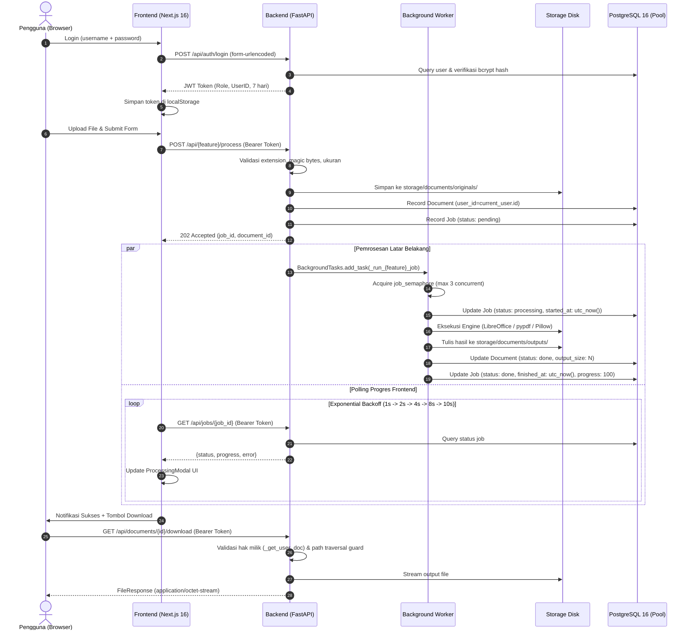
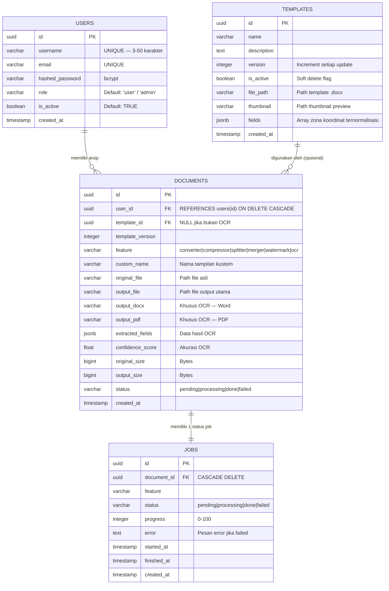

# SMARTDOC — Comprehensive System Architecture & Project Documentation

Struktur folder dan katalog endpoint aktif: [docs/ARCHITECTURE.md](docs/ARCHITECTURE.md).

Dokumen ini berisi analisis menyeluruh mengenai arsitektur sistem, alur kerja, struktur data, relasi basis data, isolasi data multi-tenancy, kontrol akses berbasis peran (RBAC), mekanisme pemrosesan asinkron, connection pooling, rate limiting, dan paginasi riwayat dokumen pada aplikasi **SmartDoc**. Diperbarui berdasarkan implementasi codebase per **22 September 2026**.

> **Pembaruan arah produk (28 Oktober 2026):** OCR dan manajemen template telah dihapus dari aplikasi. Rincian OCR/template berikut adalah catatan historis, bukan fitur aktif. Migrasi database lama sengaja dipertahankan agar data yang sudah tersimpan tidak terhapus otomatis.

---

## DAFTAR ISI
1. [Ringkasan Eksekutif](#1-ringkasan-eksekutif)
2. [Teknologi & Ekosistem (Tech Stack)](#2-teknologi--ekosistem-tech-stack)
3. [Struktur Direktori Proyek](#3-struktur-direktori-proyek)
4. [Arsitektur Sistem & Alur Global](#4-arsitektur-sistem--alur-global)
5. [Struktur Data & Relasi Database (ERD)](#5-struktur-data--relasi-database-erd)
6. [Sistem Autentikasi, Multi-Tenancy & RBAC](#6-sistem-autentikasi-multi-tenancy--rbac)
7. [Analisis Alur Kerja Fitur (Feature Deep-Dives)](#7-analisis-alur-kerja-fitur-feature-deep-dives)
   - 7.1 [Document Converter](#71-document-converter)
   - 7.2 [File Compressor](#72-file-compressor)
   - 7.3 [Document Splitter](#73-document-splitter)
   - 7.4 [Document Merger](#74-document-merger)
   - 7.5 [Watermark & Security](#75-watermark--security)
   - 7.6 [Template Engine & OCR (Admin Restricted)](#76-template-engine--ocr-admin-restricted)
   - 7.7 [Riwayat Dokumen, Paginasi & Operasi Massal](#77-riwayat-dokumen-paginasi--operasi-massal)
8. [Mekanisme Pemrosesan Asinkron & Polling (Job Lifecycle)](#8-mekanisme-pemrosesan-asinkron--polling-job-lifecycle)
9. [Sistem Validasi Berkas](#9-sistem-validasi-berkas)
10. [Manajemen Penyimpanan & File Lifecycle](#10-manajemen-penyimpanan--file-lifecycle)
11. [Katalog Referensi API (API Reference)](#11-katalog-referensi-api-api-reference)
12. [Panduan Instalasi & Runbook](#12-panduan-instalasi--runbook)
13. [Rekomendasi Fitur & Pengembangan untuk Tim Manajemen (DMS)](#13-rekomendasi-fitur--pengembangan-untuk-tim-manajemen-dms)

---

## 1. Ringkasan Eksekutif

**SmartDoc** adalah platform manajemen dan transformasi dokumen cerdas yang mengintegrasikan kebutuhan pengolahan berkas modern dalam satu antarmuka elegan, cepat, dan aman.

### Fitur Utama yang Terimplementasi:
- **Autentikasi & RBAC**: Register dan login dengan hashing bcrypt, JWT 7 hari, proteksi rate limiting anti-brute force, pemisahan peran (`user` vs `admin`), dan route guard.
- **Multi-Tenancy & Isolasi Berkas**: Isolasi kepemilikan dokumen penuh (`Document.user_id`), mencegah akses lintas pengguna (IDOR).
- **Document Converter**: Konversi multi-arah PDF, Word, Excel, PowerPoint, dan Gambar. Output kondisional cerdas (1 halaman → gambar, multi-halaman → ZIP).
- **File Compressor**: Reduksi ukuran file untuk PDF, gambar, dan dokumen Office tanpa mengorbankan kualitas teks.
- **Document Splitter**: Ekstraksi halaman via rentang selektif, interval berkala, atau pisah semua halaman; galeri thumbnail visual interaktif.
- **Document Merger**: Penggabungan multi-format ke PDF dengan mode urutan (*sequence*) dan mode sisip (*insert*).
- **Watermark & Security**: Watermark teks kustom dengan kontrol opacity, angle, warna + enkripsi password PDF.
- **Template Engine**: CRUD admin template formulir dengan koordinat ternormalisasi, versioning, proteksi khusus peran admin.
- **Riwayat Dokumen & Paginasi**: Paginasi dinamis server-side (minimal 10), pencarian full-text nama berkas, filter kategori, rename inline, batch download ZIP non-blocking, dan batch delete.

---

## 2. Teknologi & Ekosistem (Tech Stack)

```mermaid
graph TD
    subgraph Client["Frontend Layer (Next.js 16 + React 19)"]
        Auth[AuthContext + AuthGate + Role Check]
        UI[Halaman Fitur & Riwayat Dokumen]
        UploadComp[FileUpload + Drag & Drop]
        PaginationUI[PaginationBar — Min 10 / Dropdown / Smart Ellipsis]
        ModalComp[ProcessingModal + Toast]
        HookComp[useJobPolling — Exponential Backoff]
        KonvaComp[Konva Canvas — Watermark Preview]
    end

    subgraph Server["Backend Layer (FastAPI 0.110)"]
        Router[9 API Routers]
        Limiter[SlowAPI Rate Limiter — 5/min reg, 15/min login]
        BGTasks[asyncio.BackgroundTasks + Thread Pool]
        Semaphore[job_semaphore(3) + libreoffice_semaphore(1)]
        DBBase[SQLAlchemy 2.0 Async Pool — size 10, max 20]
        CleanEngine[Periodic Cleanup Task — recursive temp cleanup]
        Validator[Magic Bytes + Extension + Dimension Validator]
    end

    subgraph Processing["Processing Engines"]
        LibreOffice[LibreOffice Headless soffice]
        Poppler[Poppler / pdf2image]
        PyPDF[pypdf 4.1.0]
        Pillow[Pillow PIL 10.2.0]
        PDF2DOCX[pdf2docx 0.5.8]
        DocxTemplate[docxtpl + python-docx]
        ZipEngine[zipfile ZIP_DEFLATED via asyncio.to_thread]
    end

    subgraph Database["Data Layer"]
        PG[(PostgreSQL 16 Alpine)]
        Storage[(Local File Storage)]
    end

    Auth --> Router
    UI --> Router
    UploadComp --> Router
    HookComp --> Router
    Router --> Limiter
    Router --> DBBase
    Router --> BGTasks
    BGTasks --> Semaphore
    Semaphore --> Processing
    DBBase --> PG
    Processing --> Storage
```

### Detail Stack Teknologi Aktual:

**Frontend (Next.js 16.3.1)**:
- Framework: Next.js 16.3.1 (App Router), React 19.2.8, TypeScript
- Styling: Vanilla CSS dengan design system tokens di `globals.css` (termasuk kelas khusus paginasi)
- Ikonografi: `lucide-react ^1.33.0`
- Canvas: `konva ^10.3.1` + `react-konva ^19.2.5` (watermark live preview)
- Komunikasi: Same-origin relative proxy via Next.js `rewrites()` + typed async client (`/lib/api.ts`)
- State Auth: React Context (`AuthContext.tsx`) + localStorage + role awareness

**Backend (FastAPI 0.110.0)**:
- Framework: FastAPI (Python 3.11+), ASGI Server Uvicorn 0.28.0
- Database ORM: SQLAlchemy 2.0 async session + asyncpg 0.29.0 dengan Connection Pool (`pool_size=10, max_overflow=20, pool_pre_ping=True, pool_recycle=1800`)
- Security & Limiting: SlowAPI 0.1.9, python-jose JWT HS256, passlib bcrypt
- Config: Pydantic Settings v2 dari `.env`
- Logging: Loguru 0.7.2
- Migration: Alembic 1.13.1 (3 versi migration: Initial, Add Users, Multi-Tenancy & RBAC)
- Timezone Standard: Naive UTC helper `utc_now()` pada `app/core/datetime_utils.py`

**Processing Engines**:
- LibreOffice headless (`soffice`): Konversi DOCX/XLSX/PPTX ke PDF
- Poppler (`pdf2image`): Render thumbnail per halaman PDF (DPI 60-120)
- pypdf 4.1.0: Manipulasi halaman, merge, split, enkripsi password
- pdf2docx 0.5.8: Konversi PDF ke DOCX dengan layout terjaga
- Pillow 10.2.0: Kompresi gambar, konversi format, rendering
- docxtpl 0.16.8: Template injection Jinja2 ke DOCX (OCR)
- python-docx, openpyxl, python-pptx: Kompresi Office embedded images
- filetype 1.2.0: Magic bytes detection (validasi integritas biner)

---

## 3. Struktur Direktori Proyek

```
d:\smartdoc\
├── .env                          # Environment variables root (Docker Compose)
├── .env.example                  # Template environment variables
├── docker-compose.yml            # Orchestrasi 3 service: frontend, backend, db
├── PRD.md                        # Product Requirements Document (v1.4.0)
├── project.md                    # Dokumen arsitektur ini
├── DESIGN.md                     # Panduan desain visual
├── README.md                     # Panduan pengguna umum
├── storage/                      # Volume mount file storage
│   ├── temp/uploads/
│   ├── temp/processing/
│   ├── templates/{uuid}/         # Template OCR + thumbnail
│   └── documents/
│       ├── originals/
│       └── outputs/
├── smartdoc-backend/
│   ├── alembic/                  # Migrasi skema database (001, 002, 003)
│   ├── app/
│   │   ├── api/                  # 9 API Routers (auth, documents, converter, dll)
│   │   ├── core/                 # Config, security, limiter, validators, cleanup, datetime_utils
│   │   ├── db/                   # Async engine, connection pool, session maker
│   │   ├── models/               # ORM User, Document, Job, Template
│   │   └── services/             # Processing engines (converter, compressor, dll)
│   ├── tests/                    # Automated test suite (22 unit & E2E tests)
│   └── requirements.txt
└── smartdoc-frontend/
    ├── app/                      # App Router Next.js 16
    │   ├── (user)/               # Halaman pengguna (converter, riwayat, dll)
    │   └── (admin)/              # Halaman manajemen template khusus admin
    ├── components/               # UI components (Sidebar, FileUpload, Toast, dll)
    └── lib/                      # api.ts, AuthContext.tsx, useJobPolling.ts
```

---

## 4. Arsitektur Sistem & Alur Global

Sistem menggunakan pola **Asynchronous Job-Worker Architecture** dengan isolasi akses pengguna (*multi-tenancy*) dan koneksi database terpantau (*connection pool*).



---

## 5. Struktur Data & Relasi Database (ERD)



### Indeks Database:
- `idx_users_username` pada `users(username)` — lookup login cepat
- `idx_users_email` pada `users(email)` — cek keunikan email
- `idx_documents_user_id` pada `documents(user_id)` — isolasi data multi-tenancy
- `idx_documents_created_at` pada `documents(created_at DESC)` — paginasi arsip
- `idx_documents_feature` pada `documents(feature)` — filter per fitur
- `idx_jobs_document_id` pada `jobs(document_id)` — relasi polling job
- `idx_jobs_status` pada `jobs(status)` — monitoring antrian

### Alembic Migrations:
- `001_initial_schema.py`: Tabel dasar `documents`, `jobs`, `templates`.
- `002_add_users_table.py`: Tabel `users`.
- `003_multi_tenancy_and_rbac.py`: Penambahan kolom `role` pada `users` dan kolom relasi `user_id` pada `documents`.

---

## 6. Sistem Autentikasi, Multi-Tenancy & RBAC

### 6.1 Alur Autentikasi & Keamanan
1. **Registrasi**: `POST /api/auth/register` dengan batasan rate limit 5 req/menit via `SlowAPI`. Validasi keunikan username & email, password minimal 8 karakter, hashing bcrypt.
2. **Login**: `POST /api/auth/login` dengan batasan rate limit 15 req/menit untuk menangkis serangan brute force. Menghasilkan JWT token berisi claim `sub` (User ID), `username`, dan `role`.
3. **Role-Based Access Control (RBAC)**:
   - Dependency `require_roles(*allowed_roles)` dan `require_admin` memvalidasi hak akses.
   - Operasi penambahan, pengubahan, dan penghapusan template (`/api/templates`) mewajibkan role `admin`. User non-admin akan menerima HTTP 403 Forbidden.
   - Frontend Sidebar secara kondisional hanya memunculkan menu "Manajemen Template" jika user memiliki role `admin`.
4. **Isolasi Multi-Tenancy**:
   - Seluruh endpoint `documents` mewajibkan token JWT dan mencocokkan `Document.user_id == current_user.id`.
   - Mengeliminasi risiko kebocoran data antar-user atau manipulasi file milik user lain (IDOR).

---

## 7. Analisis Alur Kerja Fitur (Feature Deep-Dives)

### 7.1 Document Converter
- **URL**: `/converter` | **API**: `POST /api/converter/process`
- Mendukung konversi dokumen Office (`.docx`, `.xlsx`, `.pptx`) ke PDF via LibreOffice headless.
- Konversi PDF ke Word (`.docx`) via `pdf2docx` dengan penataan layout teks presisi.
- Konversi PDF ke Gambar (`.jpg`, `.png`): 1 halaman langsung file gambar, >1 halaman otomatis dikemas dalam file ZIP.
- Multi-Image to PDF: Menggabungkan hingga 50 gambar menjadi 1 PDF utuh.

### 7.2 File Compressor
- **URL**: `/compressor` | **API**: `POST /api/compressor/process`
- Mengompresi PDF menggunakan Ghostscript profile `/ebook` (150 DPI) dengan fallback ke `pypdf`.
- Mengompresi berkas gambar via Pillow (`quality=85` untuk JPG, `optimize=True` untuk PNG).
- Mengompresi dokumen Office (Word, Excel, PowerPoint) dengan mengekstrak ZIP container dan melakukan downsampling gambar embedded pada folder `media`.
- Safe Guard: Jika berkas hasil kompresi lebih besar dari aslinya, sistem otomatis mempertahankan berkas asli.

### 7.3 Document Splitter
- **URL**: `/splitter` | **API Info**: `POST /api/splitter/info` | **API Proses**: `POST /api/splitter/process`
- Menyediakan endpoint visual info yang menghasilkan galeri thumbnail halaman (DPI 60 JPEG).
- Mode `extract_range`: Ekstrak halaman tertentu (misal: `1-3, 5`).
- Mode `fixed_interval`: Memecah setiap N halaman menjadi beberapa file PDF dalam ZIP.
- Mode `all_single`: Memecah seluruh halaman menjadi file terpisah dalam ZIP.

### 7.4 Document Merger
- **URL**: `/merger` | **API Info**: `POST /api/merger/info` | **API Proses**: `POST /api/merger/process`
- Menggabungkan berbagai format dokumen (PDF, Word, Excel, PowerPoint, Gambar) menjadi 1 PDF.
- Mode `sequence`: Penggabungan berurutan sesuai antrean.
- Mode `insert`: Menyisipkan dokumen kedua ke dalam dokumen pertama pada posisi awal, akhir, atau setelah halaman tertentu.

### 7.5 Watermark & Security
- **URL**: `/watermark` | **API**: `POST /api/watermark/process`
- Menyematkan cap air teks dengan rotasi sudut bebas, transparansi, warna hex, dan ukuran font.
- Menerapkan enkripsi kata sandi standar PDF untuk membatasi akses pembukaan dokumen.

### 7.6 Template Engine & OCR (Admin Restricted)
- **URL**: `/admin/templates` | **API**: `/api/templates`
- Dikhususkan bagi pengguna dengan role `admin`.
- Mendukung pembuatan template `.docx` dengan tag Jinja2 `{{field}}` dan pemetaan koordinat ternormalisasi (0.0–1.0).
- Versioning otomatis setiap kali ada file template baru yang diunggah.

### 7.7 Riwayat Dokumen, Paginasi & Operasi Massal
- **URL**: `/riwayat-dokumen` | **API**: `GET /api/documents`
- **Paginasi Modern Server-Side**:
  - Tampilan baris minimal dan default adalah **10 dokumen per halaman**.
  - Pilihan per halaman yang tersedia: **10**, **20**, **50**, dan **100**.
  - Agregat `total_items` dan `total_pages` dihitung dinamis dari database.
- **Pencarian Nama Berkas**:
  - Parameter `search` dengan filter `ilike` pada `custom_name` dan `original_file` di seluruh database.
  - Dilengkapi *debounce* 300ms di frontend untuk mencegah spam request.
- **Komponen Navigasi Paginasi**:
  - Menampilkan informasi rentang: *"Menampilkan X–Y dari Z dokumen"*.
  - Tombol navigasi pertama (`<<`), sebelumnya (`<`), nomor halaman dengan *smart ellipsis*, berikutnya (`>`), dan terakhir (`>>`).
- **Operasi Massal (Multi-Select)**:
  - Batch Delete: Menghapus banyak dokumen terpilih sekaligus dalam single query.
  - Batch Download: Mengemas banyak dokumen terpilih ke dalam arsip ZIP di thread terpisah (`asyncio.to_thread`) tanpa memblokir server.

---

## 8. Mekanisme Pemrosesan Asinkron & Polling (Job Lifecycle)

- **Worker Concurrency**: Dibatasi oleh `job_semaphore = asyncio.Semaphore(3)` dan `libreoffice_semaphore = asyncio.Semaphore(1)`.
- **Connection Pool**: Async connection pool (`pool_size=10, max_overflow=20`) mencegah kehabisan koneksi saat banyak background task berjalan.
- **Polling Client**: Hook `useJobPolling.ts` melakukan polling dengan exponential backoff (1s, 2s, 4s, 8s, 10s max) hingga job berstatus `done` atau `failed`.
- **Timestamp Standard**: Seluruh pencatatan waktu (`started_at`, `finished_at`, `created_at`) menggunakan `utc_now()` naive UTC dari `app/core/datetime_utils.py` untuk kompatibilitas penuh dengan PostgreSQL.

---

## 9. Sistem Validasi Berkas

| Validasi | Fungsi Validator | Keterangan |
|---|---|---|
| **Ekstensi** | `validate_file_extension()` | Memeriksa format yang diizinkan per modul |
| **Ukuran (Streaming)** | `validate_and_read_upload()` | Membaca chunk 1 MB; early abort jika melewati batas (35 MB dokumen, 12 MB gambar) |
| **Magic Bytes** | `validate_file_magic_bytes()` | Memverifikasi header biner (%PDF, \x89PNG, \xff\xd8\xff, PK\x03\x04) |
| **Dimensi Gambar** | `validate_image_dimensions()` | Maksimal 10.000 x 10.000 px |
| **Halaman PDF** | `validate_pdf_pages()` | Maksimal 50 halaman dan memeriksa ada tidaknya enkripsi |

---

## 10. Manajemen Penyimpanan & File Lifecycle

```
./storage/
├── temp/
│   ├── uploads/            # Upload sementara
│   └── processing/         # Berkas antara (intermediate)
├── templates/{uuid}/       # Template DOCX dan thumbnail
└── documents/
    ├── originals/          # Berkas asli pengguna
    └── outputs/            # Berkas hasil pemrosesan
```

- **Pembersihan Otomatis**: Background task rekursif di `app/core/cleanup.py` berjalan setiap 1 jam untuk menghapus file dan folder sementara yang berumur > 24 jam.

---

## 11. Katalog Referensi API (API Reference)

| Modul | Method | Endpoint | Hak Akses | Keterangan |
|---|---|---|---|---|
| **System** | `GET` | `/health` | Public | Status kesehatan server |
| **System** | `GET` | `/` | Public | Metadata API |
| **Auth** | `POST` | `/api/auth/register` | Public (Limit 5/m) | Pendaftaran akun baru |
| **Auth** | `POST` | `/api/auth/login` | Public (Limit 15/m) | Login dan penerbitan token JWT |
| **Auth** | `GET` | `/api/auth/me` | Authenticated | Profil user aktif beserta role |
| **Jobs** | `GET` | `/api/jobs/{job_id}` | Authenticated | Status dan progres job |
| **Converter** | `POST` | `/api/converter/process` | Authenticated | Pemrosesan konversi |
| **Compressor** | `POST` | `/api/compressor/process` | Authenticated | Pemrosesan kompresi |
| **Splitter** | `POST` | `/api/splitter/info` | Authenticated | Info halaman & thumbnail |
| **Splitter** | `POST` | `/api/splitter/process` | Authenticated | Pemisahan berkas |
| **Merger** | `POST` | `/api/merger/info` | Authenticated | Validasi sebelum merger |
| **Merger** | `POST` | `/api/merger/process` | Authenticated | Penggabungan berkas |
| **Watermark** | `POST` | `/api/watermark/process` | Authenticated | Watermark & enkripsi sandi |
| **Documents** | `GET` | `/api/documents` | Authenticated | Riwayat privat (paginasi min 10 & pencarian) |
| **Documents** | `GET` | `/api/documents/{id}` | Owner Only | Detail dokumen |
| **Documents** | `GET` | `/api/documents/{id}/preview` | Owner Only | Pratinjau inline |
| **Documents** | `GET` | `/api/documents/{id}/download` | Owner Only | Pengunduhan berkas |
| **Documents** | `PATCH`| `/api/documents/{id}` | Owner Only | Pengubahan nama berkas |
| **Documents** | `DELETE`| `/api/documents/{id}` | Owner Only | Penghapusan berkas & arsip |
| **Documents** | `POST` | `/api/documents/batch-delete` | Owner Only | Penghapusan massal |
| **Documents** | `POST` | `/api/documents/batch-download` | Owner Only | Pengunduhan massal (ZIP) |
| **Templates** | `GET` | `/api/templates` | Authenticated | Daftar template |
| **Templates** | `POST` | `/api/templates` | **Admin Only** | Pembuatan template baru |
| **Templates** | `PUT` | `/api/templates/{id}` | **Admin Only** | Pembaruan template |
| **Templates** | `DELETE`| `/api/templates/{id}` | **Admin Only** | Penghapusan template |

---

## 12. Panduan Instalasi & Runbook

### Menjalankan dengan Docker Compose:
```bash
docker compose up --build -d
docker compose ps
```

### Menjalankan Manual (Development):
```bash
# 1. Backend
cd smartdoc-backend
.\.venv\Scripts\Activate.ps1
pip install -r requirements.txt
uvicorn app.main:app --reload --port 8000

# 2. Frontend
cd smartdoc-frontend
npm install
npm run dev
```

---

## 13. Rekomendasi Fitur & Pengembangan untuk Tim Manajemen (DMS)

Agar **SmartDoc** dapat bertransformasi menjadi **Sistem Manajemen Berkas Perusahaan / Document Management System (DMS)** yang siap pakai bagi tim manajemen (Direksi, HRD, Keuangan, Legal, Operasional), berikut adalah rekomendasi fitur strategis berorientasi bisnis:

### 1. Struktur Folder Departemen & Manajemen Hak Akses Tim (Workspace & Folders)
- **Masalah Saat Ini**: Seluruh berkas berada dalam satu daftar flat riwayat pengguna.
- **Rekomendasi**:
  - Hadirkan struktur direktori hierarkis (Folder & Subfolder) berdasarkan Divisi/Departemen (misal: `Legal/Kontrak`, `Finance/Faktur Pajak 2026`, `HRD/Surat Keputusan`).
  - Fitur **Shared Workspaces / Folder Sharing**: Akses folder tim dengan level permission granular (`Viewer`, `Editor`, `Approver`, `Admin`).

### 2. Alur Persetujuan & Tanda Tangan Digital (Document Approval Workflow & E-Signature)
- **Masalah Saat Ini**: Manajemen sering kali mengonversi berkas secara manual, lalu mencetak berkas untuk ditandatangani secara fisik.
- **Rekomendasi**:
  - **Approval Pipeline Multi-Level**: Pembuatan jalur persetujuan berjenjang (Draft -> Ditinjau Manager -> Disetujui Direktur).
  - **Tanda Tangan Elektronik (E-Signature) & QR Verification**: Sematkan tanda tangan digital/paraf atau QR-code verifikasi keaslian dokumen pada halaman PDF yang disetujui.

### 3. Kontrol Versi & Riwayat Revisi Berkas (Document Version Control & Audit Trail)
- **Masalah Saat Ini**: Jika sebuah dokumen direvisi, dokumen lama berisiko hilang atau tertimpa.
- **Rekomendasi**:
  - **Versioning Berkas (v1.0, v1.1, v2.0)**: Manajemen dapat melihat draf berkas terdahulu beserta catatan revisi (*changelog*).
  - **Audit Trail & Activity Log**: Log pencatatan riwayat lengkap (siapa yang mengunggah, mengunduh, menandatangani, memberi watermark, atau menghapus dokumen, lengkap dengan timestamp UTC dan alamat IP).

### 4. Tagging Metadata Kustom & Pencarian Full-Text (OCR Deep Search)
- **Masalah Saat Ini**: Pencarian berkas hanya berdasarkan nama file.
- **Rekomendasi**:
  - **Metadata Berkas**: Setiap dokumen memiliki metadata kustom (misal: *Nomor Surat*, *Tanggal Jatuh Tempo*, *Nilai Kontrak*, *Status Kepatuhan*).
  - **OCR Full-Text Search**: Kemampuan mencari kata/kalimat yang ada di dalam isi dokumen PDF/scan, bukan hanya mencari berdasarkan nama file.

### 5. Tanda Air Dinamis Otomatis untuk Dokumen Rahasia (Dynamic Security Watermarking)
- **Masalah Saat Ini**: Watermark teks disematkan secara manual oleh pengguna.
- **Rekomendasi**:
  - **Dynamic Watermark saat Download**: Untuk dokumen bertanda *Confidential*, saat staf mengunduh dokumen, sistem otomatis menyematkan watermark transparan: `"Downloaded by: [Nama Staff] - [Waktu] - [IP Address]"` untuk mencegah kebocoran data internal perusahaan.

### 6. Pengarsipan Otomatis & Notifikasi Tenggat Dokumen (Retention & Expiry Alerts)
- **Masalah Saat Ini**: Dokumen disimpan permanen tanpa pengingat masa berlaku.
- **Rekomendasi**:
  - Fitur pengingat masa berlaku dokumen legal/kontrak (misal: *"Kontrak vendor X akan habis dalam 30 hari"* via email atau notifikasi sistem).
  - Pengarsipan otomatis (*archiving policy*) untuk memindahkan berkas yang sudah kadaluarsa ke cold storage.
