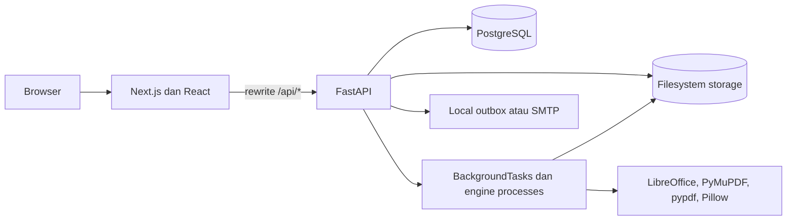
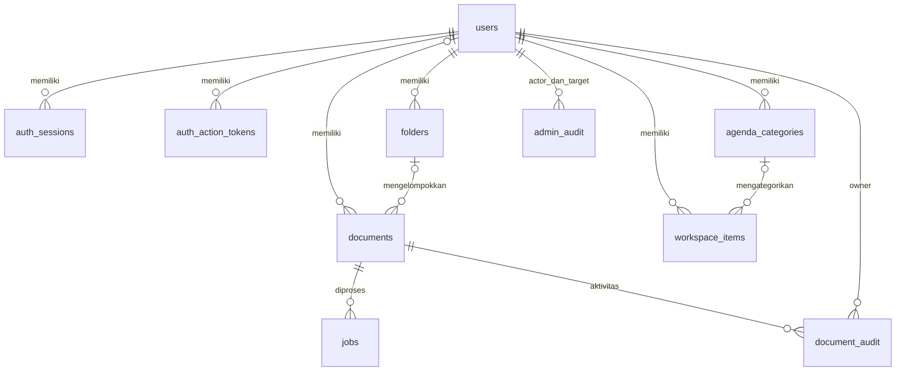

# SmartDoc — Arsitektur

Diperbarui: 6 November 2026 berdasarkan milestone auth, halaman error, success handling, dan penguatan PPTX. Backend terakhir mencatat 273 lulus pada database/storage disposable PostgreSQL 16; frontend terbaru 29 tests, typecheck, targeted lint, dan production build lulus. Ada 33 page routes frontend, ditambah framework not-found dan error boundaries. Database aplikasi pengguna tidak diubah. Bukti dan batas pemeriksaan di [task.md](task.md); kebutuhan produk di [PRD](PRD.md), dan panduan development di [README](README.md).

## Gambaran sistem

SmartDoc merupakan monorepo dengan frontend Next.js App Router dan backend FastAPI. Browser memakai origin frontend; rewrite `/api/*` meneruskan request ke backend. PostgreSQL menyimpan metadata, sedangkan filesystem menyimpan berkas. Engine dokumen berjalan pada host backend, bukan layanan eksternal. Tidak ada Redis, Celery, object storage, WebSocket, atau distributed queue pada implementasi aktif.



Versi yang dideklarasikan repository: Next.js 16.4.3, React 19.3.1, Tailwind CSS 4, TypeScript 5; FastAPI 0.162.0, SQLAlchemy 2.1.6, asyncpg 0.32.0, dan Alembic 1.20.1. Docker memakai Node 24, Python 3.11, serta PostgreSQL 16. Ini merupakan versi manifest, bukan hasil pemeriksaan dependency terpasang atau security scan terbaru.

## Database dan relasi

`app/db/base.py` membuat SQLAlchemy AsyncEngine dengan pool size 10, max overflow 20, pre-ping, dan recycle 1.800 detik. AsyncSession menggunakan `expire_on_commit=False`; commit dilakukan service/handler secara eksplisit. Dependency melakukan rollback saat exception. Berkas tidak disimpan sebagai BLOB database.

| Tabel aktif | Data penting | Relasi dan aturan |
| --- | --- | --- |
| `users` | UUID, username/email unik, bcrypt hash, role, status, token_version, verifikasi, profil/timezone, kuota | CHECK role `user`/`admin`; kuota default 500 MB |
| `auth_sessions` | token_hash unik, expiry, revoked_at, remember_me | FK user dengan CASCADE; refresh rotation membuat row baru |
| `auth_action_tokens` | purpose, token_hash unik, expiry, used_at | FK user dengan CASCADE; token verifikasi/reset sekali pakai |
| `folders` | user_id, name | FK user CASCADE; satu tingkat, tanpa parent_id atau constraint nama unik |
| `documents` | owner/folder, feature, nama, input/output paths dan ukuran, status, is_saved, save_requested, stored_size_bytes, source_paths JSONB, expires_at, storage_notice | Owner nullable untuk kompatibilitas legacy; FK user CASCADE dan folder SET NULL |
| `jobs` | document_id, feature, status, progress, error, timestamps | FK dokumen CASCADE; kepemilikan diturunkan dari Document, bukan kolom user_id |
| `agenda_categories` | owner, nama, warna hex | Unique index `(user_id, lower(name))`; FK user CASCADE |
| `workspace_items` | kind, title, description, status, priority, starts_at/ends_at/due_at, document_ids JSONB, category_id | CHECK kind task/event; kategori SET NULL; FK user CASCADE |
| `admin_audit` | actor_id, target_id, action, timestamp | FK ke users; pesan action diproyeksikan menjadi metadata allowlist pada API |
| `document_audit` | owner_id, actor_id nullable, document_id, action, outcome, code, timestamp | FK ke users/documents; index gabungan owner/document/time; tanpa CASCADE eksplisit |



`workspace_items.document_ids` berisi array UUID berbentuk string di JSONB, bukan foreign-key join table. Ownership diperiksa aplikasi saat assignment; database tidak menjaga referensi tersebut dengan FK. Penghapusan berkas mempertahankan row Document, sehingga history/audit tetap tersedia. Constraint audit juga berarti CASCADE pada resource lain tidak menjamin account deletion akan berhasil; endpoint penghapusan akun memang belum tersedia.

Jadwal agenda memakai `DateTime(timezone=True)` dan dinormalisasi ke UTC; input tanpa offset ditafsirkan memakai timezone akun. Timestamp umum dokumen/job/auth memakai UTC naive. Serialisasi belum seragam: beberapa endpoint menambah `Z`, sedangkan timestamp job masih tanpa offset. Perbaikan konsistensi dicatat dalam task.

### Kolom model aktif

Daftar berikut mencakup seluruh kolom ORM aktif. PK dan nullability dibaca dari SQLAlchemy metadata source tanpa koneksi database. Daftar ini tidak menyatakan schema live sama dengan ORM; kolom legacy dan server defaults harus dilihat bersama migration history. Default aplikasi seperti status/kuota tidak otomatis berarti seluruhnya mempunyai CHECK constraint database.

| Tabel | Kolom, tipe, dan nullability |
| --- | --- |
| `users` | `id: UUID PK NOT NULL`; `username: VARCHAR(100) NOT NULL`; `email: VARCHAR(255) NOT NULL`; `hashed_password: VARCHAR(255) NOT NULL`; `role: VARCHAR(20) NOT NULL`; `is_active: BOOLEAN NOT NULL`; `token_version: INTEGER NOT NULL`; `email_verified: BOOLEAN NOT NULL`; `display_name: VARCHAR(100) NOT NULL`; `timezone: VARCHAR(60) NOT NULL`; `onboarding_complete: BOOLEAN NOT NULL`; `storage_quota_mb: INTEGER NOT NULL`; `created_at: DATETIME NOT NULL` |
| `admin_audit` | `id: UUID PK NOT NULL`; `actor_id: UUID NOT NULL`; `target_id: UUID NOT NULL`; `action: VARCHAR(200) NOT NULL`; `created_at: DATETIME NOT NULL` |
| `agenda_categories` | `id: UUID PK NOT NULL`; `user_id: UUID NOT NULL`; `name: VARCHAR(50) NOT NULL`; `color: VARCHAR(7) NOT NULL` |
| `auth_action_tokens` | `id: UUID PK NOT NULL`; `user_id: UUID NOT NULL`; `purpose: VARCHAR(20) NOT NULL`; `token_hash: VARCHAR(64) NOT NULL`; `expires_at: DATETIME NOT NULL`; `used_at: DATETIME NULL` |
| `auth_sessions` | `id: UUID PK NOT NULL`; `user_id: UUID NOT NULL`; `token_hash: VARCHAR(64) NOT NULL`; `expires_at: DATETIME NOT NULL`; `revoked_at: DATETIME NULL`; `remember_me: BOOLEAN NOT NULL` |
| `folders` | `id: UUID PK NOT NULL`; `user_id: UUID NOT NULL`; `name: VARCHAR(100) NOT NULL` |
| `documents` | `id: UUID PK NOT NULL`; `user_id: UUID NULL`; `folder_id: UUID NULL`; `feature: VARCHAR(50) NOT NULL`; `custom_name: VARCHAR(255) NULL`; `original_file: VARCHAR(500) NOT NULL`; `output_file: VARCHAR(500) NULL`; `original_size: BIGINT NOT NULL`; `output_size: BIGINT NULL`; `status: VARCHAR(50) NOT NULL`; `is_saved: BOOLEAN NOT NULL`; `save_requested: BOOLEAN NOT NULL`; `stored_size_bytes: BIGINT NOT NULL`; `source_paths: JSONB NOT NULL`; `expires_at: DATETIME NULL`; `storage_notice: VARCHAR(30) NULL`; `created_at: DATETIME NOT NULL` |
| `workspace_items` | `id: UUID PK NOT NULL`; `user_id: UUID NOT NULL`; `kind: VARCHAR(10) NOT NULL`; `title: VARCHAR(200) NOT NULL`; `description: TEXT NOT NULL`; `status: VARCHAR(20) NOT NULL`; `priority: VARCHAR(10) NOT NULL`; `starts_at: DATETIME NULL`; `ends_at: DATETIME NULL`; `due_at: DATETIME NULL`; `document_ids: JSONB NOT NULL`; `category_id: UUID NULL`; `created_at: DATETIME NOT NULL` |
| `document_audit` | `id: UUID PK NOT NULL`; `owner_id: UUID NOT NULL`; `actor_id: UUID NULL`; `document_id: UUID NOT NULL`; `action: VARCHAR(30) NOT NULL`; `outcome: VARCHAR(10) NOT NULL`; `code: VARCHAR(30) NULL`; `created_at: DATETIME NOT NULL` |
| `jobs` | `id: UUID PK NOT NULL`; `document_id: UUID NOT NULL`; `feature: VARCHAR(50) NOT NULL`; `status: VARCHAR(50) NOT NULL`; `progress: INTEGER NOT NULL`; `error: TEXT NULL`; `started_at: DATETIME NULL`; `finished_at: DATETIME NULL`; `created_at: DATETIME NOT NULL` |

### Riwayat schema

| Migration | Perubahan |
| --- | --- |
| 001 | Schema awal templates, documents, jobs, termasuk field OCR/template legacy |
| 002–003 | Users, document owner, dan role akun |
| 004–005 | Constraint role dan token_version untuk revocation |
| 006 | Cookie sessions, action tokens, verifikasi, dan profil; akun lama ditandai verified |
| 007 | Folder, agenda task/event, dan relasi folder dokumen |
| 008–009 | Admin audit, kategori agenda, unique index dan assignment kategori |
| 010 | Pemisahan saved storage/history; completed records lama ditandai saved untuk rekonsiliasi |
| 011 | Document activity tanpa backfill aktivitas fiktif |

Head repository adalah `011_document_audit`. Tabel `templates` dan kolom seperti `template_id`, `output_docx`, `output_pdf`, `extracted_fields`, serta `confidence_score` masih dibuat oleh migration awal, tetapi tidak dipetakan model Document aktif. `alembic_version` menyimpan revision database. Dokumentasi ini tidak menyatakan database lokal sudah berada di head; pemeriksaan live memerlukan inspeksi terpisah. Migrations lama tidak boleh ditulis ulang atau data legacy dihapus otomatis.

## Frontend

### Implementasi halaman error

`app/not-found.tsx` menangani URL/resource not-found; `app/error.tsx` menangani render error child segments dan `app/global-error.tsx` menangani root layout dengan html/body serta styling mandiri. Error boundaries memakai API `retry` sesuai panduan Next.js lokal, dengan fallback `reset` jika tersedia. Shared ErrorScreen tidak bergantung pada AuthProvider atau application shell.

AuthContext membedakan 401 (refresh/login), 403 (access denied), 500 (server failure), serta jaringan/503/gateway unavailable (503 UI). AuthGate merender halaman error sebelum memasang private children, mempertahankan URL dan profil saat gangguan layanan, dan memakai retryAuth untuk membaca ulang sesi. Role mismatch yang sebelumnya redirect menjadi halaman 403 dengan tautan ke home sesuai role; backend authorization tetap acuan.

Onboarding juga menghormati error pemeriksaan sesi; gangguan layanan tidak mengarahkan pengguna ke login seolah session invalid. Metadata static 404/403/503 dan sinkronisasi judul fallback menjaga judul tab sesuai error ketika metadata route selesai streaming. Global fallback mempunyai judul dan styling sendiri.

`/akses-ditolak` dan `/layanan-tidak-tersedia` menyediakan halaman bantuan publik; 503 route memeriksa GET `/api/auth/csrf` saat retry, lalu kembali ke beranda hanya ketika layanan merespons sukses. Tidak ada global redirect untuk error form/aksi atau automatic mutation retry. UI 403/503 dari client guard tidak mengubah HTTP status initial shell; API mempertahankan status aslinya. Fitur Next forbidden/authInterrupts yang experimental tidak diperlukan pada tahap ini.

`components/errors/ServiceUnavailable.tsx` menangani probe layanan dan retryAuth sebelum navigasi; wrapper page menyediakan metadata static. `ErrorScreen.tsx` menggunakan CSS module dengan token fallbacks sehingga root global error tetap terbaca tanpa stylesheet layout. Critical fallback memakai document links agar navigasi pemulihan tidak memerlukan router/auth context. Judul client fallback disinkronkan selama error tampil, termasuk ketika metadata streaming selesai sesudah mount.

### Kontrak success feedback

`apiFetch` mempertahankan HTTP status sebagai `httpStatus` pada client envelope. JSON 2xx harus mempunyai boolean `success`; malformed payload gagal tertutup. HTTP 204 menjadi sukses tanpa data. Helper bersama membedakan completed mutation (200/201/204) dari accepted (202), serta memastikan job `done` mempunyai output positif dan download tersedia. Pembacaan/polling sukses tidak otomatis menampilkan toast. Storage fields job mengikuti payload backend.

`Toast` mempertahankan API `showToast(type, message, title?, duration?)`, dengan maksimum tiga pesan nonmodal dan dismiss per pesan. Status form dan panel hasil tetap berada di halaman. Reset password memakai konfirmasi pada route yang sama; verifikasi/profil memberi feedback sesudah validasi respons, login tetap redirect. Guest hanya menerima hasil binary tidak kosong; respons JSON/HTML dan 202 tidak dianggap berkas selesai. Download feedback hanya menyatakan browser mulai mengunduh. Perubahan ini tidak mengubah endpoint, schema database, CSRF, atau ownership policy.

### Route dan pemilik komponen

| Route | Entry point utama |
| --- | --- |
| `/`, lima URL tools publik | GuestTools, GuestToolPage, GuestToolForm, PublicShell |
| `/login`, `/admin/login` | Shared LoginForm dengan portal role masing-masing |
| `/register`, `/auth/[action]`, `/pengaturan`, `/administration/profile` | AuthScreen; action mencakup onboarding, verifikasi, forgot/reset password |
| `/terms` | Ketentuan local testing |
| `/akses-ditolak`, `/layanan-tidak-tersedia` | Shared ErrorScreen dan ServiceUnavailable; halaman bantuan publik |
| `/dashboard` | `components/workspace/Dashboard.tsx` |
| `/dokumen`, `/dokumen/[id]` | Documents, DocumentDetails, StoredDocumentPreview/Tools, DocumentActivity |
| `/kalender`, `/tugas` | Planner; `/tugas` redirect ke kalender |
| `/converter`, `/compressor`, `/splitter`, `/merger`, `/watermark` | Halaman private tool dengan shared upload, storage controls, dan processing modal |
| `/riwayat-dokumen` | History proses dan download/batch actions |
| `/administration` dan users/detail/processes/health/audit/settings | `components/admin/*`, AdminNavigation |

`app/(user)/layout.tsx` memasang AuthGate dan Sidebar. Route group ini juga menampung console Admin; AuthGate membedakan role berdasarkan URL dan memaksa onboarding sebelum workspace. Ini bukan pengganti dependency authorization backend.

`lib/api/client.ts` menangani envelope JSON, `lib/api/files.ts` dan DownloadLink menangani binary, `lib/session.ts` mengirim cookie/CSRF dan koordinasi refresh, sedangkan `lib/api/workspace.ts` dan `admin.ts` menghubungkan resource clients. `lib/document-tools.ts` membatasi tool sumber tersimpan berdasarkan format: PDF/DOCX mendukung kelima tools; XLSX/PPTX/gambar mendukung converter/compressor/merger; ZIP tidak didukung.

`useJobPolling` memulai polling 1 detik dengan backoff hingga 10 detik. Error jaringan menghentikan polling; belum ada automatic resume lintas refresh/navigasi. Browser Notification dapat dipakai untuk job selesai bila izin telah diberikan; ini tidak menyediakan background email/push scheduler. Dashboard memuat reminders tiap 60 detik saat terpasang; monitoring Admin tiap 15 detik saat terlihat.

Struktur styling menerapkan [pedoman desain](DESIGN.md). `app/tokens.css` mengatur canvas putih, neutral surfaces, border Ash, aksen Electric Blue, typography, dan radius. `globals.css` menyediakan primitive bersama untuk private tools; `workspace.css` mengatur katalog publik, form Guest, autentikasi, workspace, kalender, dan Admin. `page-layouts.css` mengatur hierarki halaman, kelompok dashboard, layout list/editor desktop, label hari kalender, dan tabel Admin. Palet pastel lama, panel besar membulat, floating sidebar, dan ikon dekoratif berdimensi telah diganti.

Ukuran, warna, typography, dan interaction states mengacu pada [pedoman visual SmartDoc](DESIGN.md#pedoman-visual-smartdoc).

Landing page berisi katalog tools. Setiap Guest tool memiliki URL publik dan memakai `PublicShell` untuk navigasi/footer. Styling tidak mengubah workflow Guest maupun aturan otorisasi.

`app/fields.css` menjadi layer presentasi field text, number/date, select, textarea, checkbox/radio, dan range, termasuk hover, focus, disabled, dan validation states. `components/ui/TextField.tsx` menyediakan ikon dan password visibility toggle tanpa mengubah nilai yang dikirim. `FilePicker.tsx` mempertahankan native file input yang dapat difokuskan melalui keyboard, meneruskan change event, dan membersihkan nama berkas saat form reset. Upload Guest dan workspace menggunakan picker bersama.

```text
smartdoc-frontend/
  app/
    layout.tsx                 # Global CSS, AuthProvider, ToastContainer
    page.tsx                   # Katalog Guest pada /
    login/                     # Login User pada /login
    admin/login/               # Login Admin pada /admin/login
    (user)/
      layout.tsx               # AuthGate dan application shell
      dashboard/page.tsx       # Workspace dengan autentikasi
      converter/ compressor/ splitter/ merger/ watermark/
      riwayat-dokumen/
  components/
    layout/                    # AuthGate, Sidebar
    auth/LoginForm.tsx         # Form bersama dengan role sesuai portal
    DownloadLink.tsx           # Fetch berbasis sesi dan Blob download
    workspace/                 # Detail, preview, dan tools saved documents
    admin/                     # Console administrasi
  hooks/
    useJobPolling.ts           # Polling berurutan dengan backoff
    useFilePreview.ts          # Blob preview dan URL cleanup
  lib/
    AuthContext.tsx            # Profil dan lifecycle akun
    auth-token.ts              # Role login dan cleanup token legacy
    session.ts                 # Transport cookie/CSRF dan koordinasi refresh
    file-validation.ts         # Validasi dan batas berkas/gambar
    format.ts                  # Format ukuran berkas
    api/
      client.ts types.ts files.ts
      jobs.ts documents.ts workspace.ts admin.ts
      workspace-types.ts admin-types.ts
      converter.ts compressor.ts splitter.ts merger.ts watermark.ts
      index.ts
```

Route group tidak mengubah URL publik. Request `/api/*` pada browser memakai Next.js rewrite menuju FastAPI. `API_INTERNAL_URL` menunjuk backend; Docker menggunakan alamat yang dapat dijangkau container frontend, misalnya `http://backend:8000`. Development native memakai `http://127.0.0.1:8001`.

`AuthGate` mengatur UI sesuai sesi, sementara dependency backend memeriksa autentikasi dan kepemilikan secara mandiri. Browser menggunakan HttpOnly access/refresh cookies serta signed session-bound CSRF token yang dapat dibaca client. React Context menyimpan profil/state. Shared transport mengirim credentials, menambahkan CSRF header untuk mutation, mencoba refresh satu kali, dan mengoordinasikan refresh antar-tab menggunakan Web Locks jika tersedia. Transport file dan JSON menggunakan jalur sesi yang sama. localStorage hanya menyimpan preferensi role/session-change, bukan token autentikasi.

## Backend dan kontrak endpoint

`app/api/` mengelompokkan HTTP endpoint menurut fitur/resource. `app/schemas/` berisi shared request validation, `app/services/` berisi document engines, `app/models/` berisi ORM models, dan `app/core/` berisi konfigurasi, security, storage containment, concurrency, serta response helpers.

Inventaris berikut diekstrak dari decorators router pada source code; handler merujuk modul dalam `app/api/`. Ada 59 route aplikasi pada router, ditambah tiga route root/health.

| Method | Endpoint | Akses | Handler |
| --- | --- | --- | --- |
| GET | `/api/admin/overview` | Admin | `admin.overview` |
| GET | `/api/admin/jobs` | Admin | `admin.jobs` |
| GET | `/api/admin/health` | Admin | `admin.health` |
| GET | `/api/admin/settings` | Admin | `admin.service_settings` |
| GET | `/api/admin/users` | Admin | `admin.users` |
| GET | `/api/admin/users/{user_id}` | Admin | `admin.user_detail` |
| PATCH | `/api/admin/users/{user_id}` | Admin | `admin.update_user` |
| POST | `/api/admin/users/{user_id}/revoke-sessions` | Admin | `admin.revoke_sessions` |
| GET | `/api/admin/audit` | Admin | `admin.audit_log` |
| GET | `/api/auth/csrf` | Publik; menerbitkan CSRF | `auth.csrf` |
| POST | `/api/auth/register` | Publik; CSRF untuk mutations | `auth.register` |
| POST | `/api/auth/login` | Publik; CSRF untuk mutations | `auth.login` |
| POST | `/api/auth/admin/login` | Publik; CSRF untuk mutations | `auth.admin_login` |
| GET | `/api/auth/me` | Akun aktif | `auth.me` |
| PATCH | `/api/auth/profile` | Akun aktif | `auth.edit_profile` |
| POST | `/api/auth/refresh` | Publik; CSRF untuk mutations | `auth.refresh` |
| POST | `/api/auth/logout` | Publik; CSRF untuk mutations | `auth.logout` |
| POST | `/api/auth/resend-verification` | Publik; CSRF untuk mutations | `auth.resend` |
| POST | `/api/auth/forgot-password` | Publik; CSRF untuk mutations | `auth.forgot` |
| POST | `/api/auth/verify-email` | Publik; CSRF untuk mutations | `auth.verify_email` |
| POST | `/api/auth/reset-password` | Publik; CSRF untuk mutations | `auth.reset_password` |
| POST | `/api/compressor/process` | Akun aktif dan owner bila terkait resource | `compressor.compress_file` |
| POST | `/api/converter/process` | Akun aktif dan owner bila terkait resource | `converter.convert_file` |
| GET | `/api/documents` | Akun aktif dan owner bila terkait resource | `documents.list_documents` |
| POST | `/api/documents/first-page-preview` | Akun aktif dan owner bila terkait resource | `documents.generate_first_page_preview` |
| GET | `/api/documents/{doc_id}/download` | Akun aktif dan owner bila terkait resource | `documents.download_document` |
| GET | `/api/documents/{doc_id}/preview` | Akun aktif dan owner bila terkait resource | `documents.preview_document` |
| GET | `/api/documents/{doc_id}/activity` | Akun aktif dan owner bila terkait resource | `documents.document_activity` |
| GET | `/api/documents/{doc_id}` | Akun aktif dan owner bila terkait resource | `documents.get_document` |
| PATCH | `/api/documents/{doc_id}` | Akun aktif dan owner bila terkait resource | `documents.rename_document` |
| POST | `/api/documents/{doc_id}/save` | Akun aktif dan owner bila terkait resource | `documents.save_document` |
| DELETE | `/api/documents/{doc_id}` | Akun aktif dan owner bila terkait resource | `documents.delete_document` |
| POST | `/api/documents/batch-delete` | Akun aktif dan owner bila terkait resource | `documents.batch_delete_documents` |
| POST | `/api/documents/batch-download` | Akun aktif dan owner bila terkait resource | `documents.batch_download_documents` |
| POST | `/api/guest/preview` | Publik | `guest.guest_preview` |
| POST | `/api/guest/{feature}` | Publik | `guest.guest_process` |
| GET | `/api/jobs/{job_id}` | Akun aktif dan owner bila terkait resource | `jobs.get_job_status` |
| POST | `/api/merger/info` | Akun aktif dan owner bila terkait resource | `merger.get_merger_document_info` |
| POST | `/api/merger/process` | Akun aktif dan owner bila terkait resource | `merger.merge_files` |
| POST | `/api/splitter/info` | Akun aktif dan owner bila terkait resource | `splitter.get_document_info` |
| POST | `/api/splitter/process` | Akun aktif dan owner bila terkait resource | `splitter.split_document` |
| POST | `/api/watermark/process` | Akun aktif dan owner bila terkait resource | `watermark.process_watermark_or_security` |
| GET | `/api/workspace/summary` | Akun aktif dan owner bila terkait resource | `workspace.summary` |
| GET | `/api/workspace/folders` | Akun aktif dan owner bila terkait resource | `workspace.folders` |
| POST | `/api/workspace/folders` | Akun aktif dan owner bila terkait resource | `workspace.create_folder` |
| PATCH | `/api/workspace/folders/{folder_id}` | Akun aktif dan owner bila terkait resource | `workspace.rename_folder` |
| DELETE | `/api/workspace/folders/{folder_id}` | Akun aktif dan owner bila terkait resource | `workspace.delete_folder` |
| GET | `/api/workspace/documents` | Akun aktif dan owner bila terkait resource | `workspace.documents` |
| POST | `/api/workspace/documents` | Akun aktif dan owner bila terkait resource | `workspace.upload_document` |
| GET | `/api/workspace/documents/{document_id}` | Akun aktif dan owner bila terkait resource | `workspace.document_detail` |
| PATCH | `/api/workspace/documents/{document_id}/folder` | Akun aktif dan owner bila terkait resource | `workspace.move_document` |
| GET | `/api/workspace/categories` | Akun aktif dan owner bila terkait resource | `workspace.categories` |
| POST | `/api/workspace/categories` | Akun aktif dan owner bila terkait resource | `workspace.create_category` |
| PATCH | `/api/workspace/categories/{category_id}` | Akun aktif dan owner bila terkait resource | `workspace.update_category` |
| DELETE | `/api/workspace/categories/{category_id}` | Akun aktif dan owner bila terkait resource | `workspace.delete_category` |
| GET | `/api/workspace/items` | Akun aktif dan owner bila terkait resource | `workspace.items` |
| POST | `/api/workspace/items` | Akun aktif dan owner bila terkait resource | `workspace.create_item` |
| PUT | `/api/workspace/items/{item_id}` | Akun aktif dan owner bila terkait resource | `workspace.update_item` |
| DELETE | `/api/workspace/items/{item_id}` | Akun aktif dan owner bila terkait resource | `workspace.delete_item` |
| GET | `/`, `/health`, `/ready` | Publik | `main.root`, `main.health_check`, `main.readiness` |

FastAPI juga menyediakan `/docs`, `/redoc`, dan `/openapi.json` secara default. Payload fitur banyak dikembalikan melalui JSONResponse manual; OpenAPI belum menjadi sumber lengkap tipe respons. Frontend memelihara interface sendiri di `lib/api/*types.ts`.

Endpoint privat menerima HttpOnly session cookies atau Bearer token eksplisit; cookie mutations membutuhkan signed CSRF header. Registrasi, login, dan tindakan email bersifat publik dengan CSRF protection. Respons JSON menggunakan `{success, data, message, error}`; login mengembalikan profil tanpa raw token. Endpoint file mengembalikan binary. Input tidak valid menggunakan 400/422, ukuran berlebih 413, dan resource tidak tersedia/tidak dimiliki 404. Mode atau parameter numerik tidak valid ditolak sebelum job dibuat.

## Role, autentikasi, dan sesi

### Implementasi milestone auth

Semua access JWT wajib membawa `sid`, issuer `smartdoc`, audience `smartdoc-api`, `token_use=access`, `iat`, `exp`, UUID subject dan token_version nonnegatif. Bearer menggunakan pemeriksaan sesi yang sama dengan cookies; JWT stateless lama tidak diterima. Tidak ada endpoint penerbitan token service terpisah.

Mutations lifecycle memakai account row lock sebagai urutan pertama, lalu session/action token row. Login memverifikasi password dan status di bawah account lock. Refresh mempertahankan absolute expiry; replay mencabut semua sesi. Reset/verify mencari owner token terlebih dahulu, mengunci akun lalu membaca ulang token dengan lock sehingga token sekali pakai dan status terbaru dinilai setelah menunggu. Admin revoke/suspend berbagi urutan account-before-session.

Logout mengembalikan `data.scope=account` dan `revoked=true` hanya setelah revocation commit untuk refresh token dikenal yang belum expired, termasuk row yang telah dirotasi. Kasus lain membersihkan cookies dengan `scope=browser`, `revoked=false`; pesan tidak mengklaim perangkat lain keluar. Lifetime access cookie/token dibatasi remaining session lifetime. Expired refresh ditolak sebelum replay revocation. CLI credentials update juga mencabut sesi di bawah account lock. Race tests memakai koneksi PostgreSQL independen dan assert tidak ada sesi yang bertahan setelah revocation yang berhasil.

Batas kepercayaan dan ketentuan keamanan lintas modul tersedia di [security.md](security.md).

Guest merupakan pengunjung tanpa autentikasi, bukan database account/JWT role. Halaman publik `/konversi`, `/kompresi`, `/pisah-halaman`, `/gabung-berkas`, dan `/watermark-sandi` berbagi navbar/footer. Private tools tetap memerlukan autentikasi. Public tools menggunakan IP-based rate limits, batas request/file/page, dan bounded concurrency.

Berkas Guest memakai direktori unik `temp/guest/request-*`, dihapus setelah respons selesai atau saat error/disconnect. Startup menghapus crash leftovers. Download memakai `Cache-Control: no-store`; Blob browser hanya dipertahankan hingga reset/navigasi. Guest tools tidak menyimpan history akun, termasuk ketika pengunjung sedang login.

Login User menuju `/dashboard`, Admin menuju `/administration`, dan logout menuju `/`. Portal login adalah `/login` dan `/admin/login`. Login dengan role yang salah menghasilkan 403 tanpa token. Kedua endpoint login berbagi batas 15 percobaan per menit per client. Registrasi menerima email/password/confirm_password/accept_terms, menolak field tambahan seperti role, dan membuat User unverified. Link verifikasi/reset sekali pakai masuk ke local inbox development; verifikasi membuat sesi dan onboarding mengumpulkan display_name/timezone.

Frontend memisahkan workspace User dari console Admin: users, processes, health, audit, settings, dan profile. Route monitoring frontend adalah `/administration/processes`, sementara API-nya `/api/admin/jobs`. AuthGate menolak navigasi silang sebelum memasang isi halaman, sedangkan `/api/admin/*` memeriksa role Admin dari database. `require_admin` menggunakan role akun terkini, bukan hanya JWT claim. Akun nonaktif dan role tidak didukung ditolak. Console tidak memberi akses dokumen/agenda pribadi akun lain.

Cookie browser membawa satu sesi saat ini; beberapa perangkat dapat memiliki sesi database masing-masing. Logout menaikkan token version akun dan mencabut sesi lintas perangkat; browser membersihkan state sesi setelah konfirmasi server. Expiry mengarahkan ke portal role terakhir. Migration 006 menambahkan cookie sessions, membatalkan JWT lama, dan menandai akun lama verified untuk mempertahankan akses lokal. Registrasi baru wajib verifikasi.

Migration `004_restrict_user_roles` menambahkan CHECK constraint untuk `user`/`admin`. Migrations berjalan saat startup. Provisioning eksplisit memakai `seed_user.py --username NAME --email EMAIL --role admin` atau `--role user`; role assignment tidak tersedia dalam registrasi publik.

Private processing menghasilkan `job_id` dan `document_id`. FastAPI BackgroundTasks mengorkestrasi tiga execution slots. Admission memakai transaction advisory lock untuk default maksimum dua job pending/processing per akun dan dua belas global, sebelum staging working files, serta memeriksa free disk. Satu backend memegang runtime lock; beberapa Uvicorn workers pada database yang sama tidak didukung. Restart menandai proses terputus sebagai gagal dan memberi expiry pada unsaved working files. Saved sources dipertahankan; tidak ada distributed queue atau automatic resume.

Historical migrations dan kolom database tetap dipertahankan untuk kompatibilitas data. Route serta active ORM fields OCR/template telah dihapus.

## Lifecycle job dan keutuhan dokumen

### Payload JSON dan autentikasi

| Operasi | Payload atau aturan |
| --- | --- |
| Register | email, password minimal 8 karakter/maksimal 72 byte UTF-8, confirm_password, accept_terms; extra fields ditolak |
| Login User/Admin | email, password, remember_me default false; JSON, bukan OAuth form; hanya portal dengan role sesuai |
| Verify email | token; verifikasi menghasilkan profil dan session cookies |
| Forgot/resend | email; respons generik untuk membatasi informasi keberadaan akun |
| Reset password | token dan password baru; konfirmasi password tidak merupakan field schema backend |
| Profile | display_name 1–100 karakter setelah aturan trim dan timezone yang diizinkan; sekaligus menandai onboarding selesai |
| Refresh/logout | Tidak memerlukan payload JSON; refresh cookie dan CSRF menjadi input sesi |
| Folder | name 1–100 karakter; nama kosong setelah trim ditolak; move menerima folder_id UUID atau null |
| Kategori | name 1–50 karakter, color hex enam digit; duplicate case-insensitive menghasilkan 409 |
| Agenda | kind task/event, title 1–200, description maksimum 5.000, status/priority, waktu opsional, maksimal 20 document_ids, category_id opsional; PUT mengganti nilai dari keseluruhan schema, bukan partial PATCH |
| Admin update user | is_active dan storage_quota_mb keduanya diperlukan; kuota 10–100.000 MB; API ini tidak menerima perubahan role |

Event memerlukan starts_at dan ends_at dengan ends_at sesudah starts_at; task mengosongkan starts_at/ends_at, event mengosongkan due_at. Extra fields ditolak pada schema auth/workspace/Admin. Nilai enum dan rentang lainnya mengikuti source handler, bukan hanya label UI.

### Input/output document tools

| Fitur | Input dan opsi utama | Output |
| --- | --- | --- |
| Converter | DOCX/XLSX/PPTX ke PDF; JPG/JPEG/PNG satu atau banyak ke PDF; PDF ke DOCX/JPG/PNG | PDF/DOCX; PDF ke gambar Guest selalu ZIP, privat satu halaman berupa gambar dan banyak halaman ZIP |
| Compressor | PDF, DOCX, XLSX, PPTX, JPG/JPEG/PNG; kualitas dari konfigurasi server | Format sumber; salinan valid dapat dikembalikan saat ukuran tidak berkurang |
| Splitter | PDF/DOCX; privat `extract_range`, `fixed_interval`, `all_single`; Guest `range`, `chunks`, `all` | Ekstraksi rentang PDF atau DOCX; chunks/single pages berupa ZIP |
| Merger | Format converter; privat `sequence`/`insert`, Guest `combine`/`insert`; insert tepat dua input, `start`/`end`/`custom` | PDF; Office/gambar dikonversi terlebih dahulu |
| Watermark | PDF/DOCX; teks dan/atau password; opacity, angle, font_size, color_hex | PDF; password memakai AES-128 pada engine pypdf |

Lima private process endpoints menggunakan multipart `file` atau repeated `files`, serta dapat menerima `source_document_id` dan repeated `source_document_ids`. `save_to_workspace` default false; `custom_title` tersedia sesuai handler. Saved-source resolver memeriksa owner, saved status, availability, dan membuat snapshot input. Sumber tetap dipertahankan. Guest memakai repeated `files` tanpa saved-source API, serta mengirim hasil secara sinkron tanpa job polling.

Ukuran per-file PPTX pada backend validator adalah 200 MB, tetapi total batch normal tetap 35 MB. Pengecualian total 200 MB berlaku pada kompresi PPTX. Frontend opt-in `allowLargePptx` dipakai kompresi; converter/merger tetap memakai batas biasa. Direct workspace upload divalidasi backend per ekstensi dan kuota. Jadi dukungan kompresi 200 MB tidak berarti setiap tool menerima PPTX 200 MB.

Request JSON menggunakan envelope `{success, data, message, error}`, sedangkan hasil download memakai binary. Private process endpoints umumnya mengembalikan 202 dengan `job_id` dan `document_id`; upload workspace dan pembuatan resource menggunakan 201. Error mencakup 400/422 untuk input, 401 untuk autentikasi, 403 untuk izin/origin, 404 untuk resource tidak dimiliki, 409 untuk konflik/state, 410 untuk sumber sementara tidak tersedia, 413 untuk batas ukuran/kuota, 429 untuk kapasitas/rate limit, dan 503 untuk layanan tidak siap.

| Resource | Pagination dan batas aktual |
| --- | --- |
| History `/api/documents` | page default 1, limit default 10/maksimum 100; `total_items`, `total_pages`, `items` |
| Saved list `/api/workspace/documents` | page, search, folder_id; 50 record per halaman; `total`, `items` |
| Agenda `/api/workspace/items` | Optional kind; maksimum 500 record terbaru per respons, tanpa pagination |
| Lampiran agenda | Maksimum 20 document IDs pada schema input |
| Activity dokumen | page/limit default 25, maksimum 100 |
| Admin users | 10 per halaman; pencarian email |
| Admin jobs/audit | 25 per halaman; jobs memiliki filter feature/status/period |
| Batch download/delete | Maksimum 100 IDs |

Summary workspace menghitung semua Document milik akun, open tasks, saved bytes, dan maksimal 20 reminders; document_count bukan jumlah saved files yang terlihat pada daftar workspace. Folder tidak memiliki parent/nesting. Nama kategori unik case-insensitive, tetapi nama folder tidak memiliki constraint unik.

### Transisi job

- `services/document_jobs.py` memusatkan start/complete/fail untuk lima private tools. State Job/Document committed bersama. Completion memerlukan output non-empty, termasuk ketika compressor mengembalikan salinan tanpa perubahan. Failure melakukan rollback sebelum mencatat kegagalan dan menghapus input/output yang ditentukan dalam storage.
- `services/job_recovery.py` mengelola single-runtime PostgreSQL lock. Unsaved interrupted documents memperoleh TTL dan dibersihkan melalui `cleanup_expired_results`; incomplete outputs tidak dapat diunduh. Saved/completed documents dipertahankan.
- Download/preview output mengembalikan 409 untuk dokumen yang belum selesai. Batch download hanya menyertakan completed documents. Guest tetap memakai lifecycle temporary files terpisah tanpa history.
- `core/workers.py` menjalankan CPU engines melalui `run_engine` dalam spawned processes dengan timeout/cancellation, lalu reap sebelum cleanup. Windows Job Objects mencakup descendants; Linux menggunakan process groups. `run_sync` untuk I/O singkat menunggu thread selesai. Async wrappers external engine juga reap subprocess pada cancellation. Ini bukan durable queue atau klaim bahwa seluruh legacy helper telah diisolasi.
- `core/page_ranges.py` menjadi strict parser bersama: one-based input, zero-based output terurut dan unik, serta penolakan input malformed, reversed, atau out-of-bounds. Job privat memeriksa page count setelah konversi Word jika diperlukan.
- `services/documents.py` berbagi ownership filtering, counting, dan stable pagination untuk history/workspace. Response shape, page size, folder ownership, dan pencarian original filename tetap merupakan policy endpoint. Record OCR historis dikeluarkan dari kedua daftar.
- Frontend workspace/Admin memanggil resource clients; kontrak data berada di luar komponen UI. File validation, format ukuran, session transport, serta binary responses memiliki implementasi bersama. Preview/info rendering dan halaman tools besar masih menjadi kandidat refactor.

## Kompresi PPTX Seimbang

Penguatan resource: `core/uploads.py` melakukan staging PPTX ke disk dalam chunk 1 MB, memakai validator ukuran dan archive yang sama. Guest compressor, private compressor, dan direct workspace upload memakai helper ini. Saved-source resolver memakai `SpooledTemporaryFile` dengan threshold 1 MB dan copy terbatas di thread yang ditunggu sampai selesai sebelum cleanup. Ownership, account lock, kuota, dan batas tool tetap berlaku.

`services/compressor/pptx_archive.py` memisahkan lifecycle PPTX dari optimasi legacy DOCX/XLSX. Validator menerima bytes atau path/file sehingga engine tidak membaca seluruh container. Sebelum fallback diizinkan, hash seluruh input parts dihitung secara streaming sekaligus memeriksa CRC. Entry besar yang tidak dioptimalkan disalin dengan chunk terbatas; optimasi raster dibatasi 32 MB encoded dan default 8 juta pixels (`MAX_PPTX_IMAGE_PIXELS`). Gambar di atas budget tetap disalin utuh. Output sementara berada di direktori tujuan, diperiksa terhadap batas archive dan manifest komponen, lalu dipublikasikan melalui atomic replace. Jika kandidat gagal, salinan sumber valid dipublikasikan melalui cara yang sama. Staging/commit failures membersihkan berkas baru; tidak ada automatic retry mutation.

Temporary output PPTX memakai nama turunan ID output yang didaftarkan dalam `Document.source_paths`. Timeout/cancellation compressor menunggu penghentian worker lalu menandai gagal dan membersihkan staging. Setelah crash/restart, lifecycle recovery dan TTL memakai daftar path yang sama sehingga temporary output tidak menjadi orphan tanpa record. Tidak ada publikasi output parsial. Startup menolak konfigurasi request yang lebih kecil daripada batas file/batch ditambah margin multipart 2 MB.

Batas RAM tidak dinyatakan sebagai SLA proses: decode gambar, multipart parser, filesystem cache, concurrent requests, dan proxy tetap memakai resource. Load/deployment checks mengikuti milestone rilis. Next.js local/self-hosted menerima batas proxy 202 MB; [Vercel Functions](https://vercel.com/docs/functions/limitations#request-body-size) mempunyai hard payload limit 4,5 MB bila request melewati Function. External rewrites merupakan jalur reverse proxy tersendiri; dukungan upload/deadline pada deployment Vercel belum dibuktikan oleh pengujian lokal. Deployment besar memerlukan ingress/backend yang mendukung body dan timeout tersebut.

`services/compressor/pptx_images.py` menerapkan optimasi JPEG/PNG yang sama dengan versi Seimbang yang diuji pada file pengguna. Default `COMPRESSION_PPTX_MODE=balanced`; `lossless` mempertahankan seluruh byte isi komponen. JPEG memakai kualitas default 85 dan mempertahankan APP metadata, termasuk EXIF orientation. PNG memakai optimasi warna dengan pemeriksaan error warna, metadata, resolusi, dan alpha channel. Gambar animasi, color-key transparency, format/mode yang tidak didukung, precision yang tidak aman, atau hasil yang tidak lebih kecil menggunakan data asli.

`services/compressor/pptx_archive.py`, dipanggil oleh `office.compress_pptx`, mempertahankan daftar/urutan komponen dan archive comment. Seluruh komponen selain gambar yang dioptimalkan dibandingkan dengan SHA-256. Gambar dioptimalkan divalidasi terlebih dahulu dan hash hasilnya diperiksa kembali sesudah ZIP ditulis. Bila ada komponen hilang/berubah tidak sesuai, hasil diganti dengan salinan sumber. Slide XML, teks, notes, relasi, font, chart, embedded objects, dan media lain tetap utuh.

Batas PPTX adalah 200 MB, request multipart 202 MB, 20.000 internal entries, 512 MB total dekompresi, dan 200 MB per entry. Office lain tetap memiliki batas entry tersendiri. Duplicate entries memiliki error terpisah dari component-count limit. Resolusi dan transparansi gambar dipertahankan; warna/detailnya dapat berubah. Kompresi PPTX tidak memanggil rendering preview PDF. Guest, User, dan saved-source tools memakai engine bersama; UI menampilkan ukuran output aktual dari berkas/job.

## Administrasi dan privacy

`services/admin_reporting.py` memakai response projections eksplisit. `/api/admin/jobs` tidak mengambil raw job error atau join private documents; hanya process metadata dan `PROCESS_FAILED`, dengan feature/status filters serta pagination. Monitoring awal menampilkan seluruh active jobs lintas tanggal. History default 24 jam berdasarkan creation time, dengan pilihan 7 hari/all-time; filter waktu tidak menghapus record. Audit mengklasifikasikan account/session actions yang dikenal dan menyembunyikan arbitrary free text.

Daftar akun berisi 10 record, job/audit 25, dengan total counts. Nomor baris berkelanjutan dan pagination hanya muncul di atas 10 akun. Baris/email tidak bernavigasi; access-settings icon yang keyboard-accessible membuka `/administration/users/[id]`. `/api/admin/users/{id}` mengembalikan allowlisted account metadata. Account list/detail memiliki `storage_used_bytes` dari grouped query `services/storage_usage.py`, yang juga digunakan quota enforcement melalui jumlah `stored_size_bytes` dokumen tersimpan. UI menampilkan used/quota/persentase tanpa metadata dokumen.

Quota/status changes dan session revocation berada di detail akun. Password hashes, session tokens, dan isi dokumen/agenda tidak dikembalikan. Akun tidak ditemukan menghasilkan 404; non-Admin ditolak. Mutations dicatat dalam audit. Suspend mengunci account row dan mencabut sesi; Admin tidak dapat disuspend dari panel. Ownership policy tetap berlaku pada download dan agenda.

Overview mengambil statistik workspace jobs 24 jam; Guest activity tidak dihitung/disimpan sebagai history. `/api/admin/health` memeriksa database, metadata/permission storage, dan engine discovery tanpa membaca dokumen atau membuka filesystem paths. `/api/admin/settings` menampilkan allowlist limits/privacy read-only tanpa environment dump/credentials, termasuk batas PPTX. `components/admin` berisi layar terpisah dan shared loading/error/pagination. Monitoring refresh tiap 15 detik saat terlihat; health diperiksa sesuai request. Hak operator infrastruktur terpisah dari izin aplikasi.

## Resource workspace dan engine lokal

### Startup, storage, dan deployment

Startup memegang PostgreSQL advisory runtime lock, menjalankan Alembic upgrade head, menandai job terputus, merekonsiliasi stored bytes dari filesystem, membersihkan expired results dan Guest orphans, menyiapkan direktori, lalu memasang cleanup loop satu jam. Kegagalan runtime lock atau migration menggagalkan startup. Shutdown membatalkan loop dan menutup engine database.

Storage native default relatif terhadap working directory backend; Docker menggunakan `/app/storage` dengan bind mount root repository. Direktori `documents/originals` menyimpan direct uploads; private process handlers memakai `work/` untuk input dan `results/` untuk output. Preview/info dan batch ZIP memakai `temp/`; Guest memakai `temp/guest/request-*`. Startup juga membuat `documents/outputs` dan `temp/uploads`/`temp/processing`, tetapi direktori tersebut bukan lokasi utama private process handlers saat ini. Path saved result dipertahankan saat save agar download berjalan tidak terputus; TTL mengikuti status database, bukan sekadar nama direktori.

Private completion menghapus working sources/snapshots setelah output tersedia; dokumen sumber tersimpan tetap berada pada record/path asalnya. Auto-save gagal kuota menghasilkan `storage_notice=quota_exceeded` dengan hasil temporary. Remove mengosongkan path dan stored bytes, melepas folder, mempertahankan row serta history. Rekonsiliasi startup dapat menandai saved file yang hilang sebagai `missing`.

Generic cleanup menyapu `temp` secara rekursif berdasarkan umur file. Cleanup `work`/`results` mengikuti record database melalui complete/fail/expiry; tidak ada generic orphan sweep untuk dua direktori tersebut. Compressor membersihkan staging saat validasi/write/commit gagal dan mendaftarkan temporary output PPTX untuk cleanup/recovery. Watermark/splitter masih memiliki staging sebelum commit tanpa cleanup menyeluruh; bagian tersisa dicatat pada T-064.

Kuota menghitung saved bytes; temporary processing tetap memakai kapasitas disk walaupun tidak masuk kuota akun. Free-disk admission bukan reservasi seluruh ukuran output/dekompresi. Guest menolak slot execution yang tidak tersedia, sedangkan private admission menghitung pending/processing jobs pada database. Preview memiliki semaphore tersendiri satu slot dan LibreOffice satu slot. Semuanya berada pada satu backend runtime.

Compose menunggu `/ready` sebelum frontend dimulai dan database health sebelum backend. `/health` hanya menunjukkan proses backend hidup. `/ready` menguji database, storage write, dan free disk; admin health menambah engine discovery tetapi tidak membuktikan setiap konversi berhasil. Tidak ada mail service di Compose. SMTP dasar dan local outbox dijelaskan pada security/README.

PDF-to-image serta thumbnails memakai `services/pdf_rendering.py` berbasis PyMuPDF tanpa external Poppler. Rendering per halaman mengikuti pixel budget. Native rendering dan pdf2docx menggunakan thread lock bersama. Office-to-PDF memakai LibreOffice; Windows mendeteksi `C:\Program Files\LibreOffice\program`. Next.js rewrite memberi waktu 330 detik untuk Guest processing sinkron. `JOB_TIMEOUT_SECONDS=300` membatasi engine/wrapper terkait; pipeline Guest tidak memiliki satu timeout global untuk seluruh konversi berurutan, sehingga durasi total dapat melebihi proxy timeout. Ghostscript/pngquant merupakan optional optimizers dengan Python fallbacks.

Fidelity checks mencakup password PDF tanpa whitespace trimming, watermark opacity, preservasi teks Word yang dihasilkan, EXIF orientation, dan transparent backgrounds. Office compression mempertahankan format/animasi yang tidak dioptimalkan. Image-to-PDF membatasi aggregate pixels. Batch conversion/merge privat membatasi total upload dan menghapus staged files saat request/commit gagal. Insert mode menerima tepat dua input; posisi invalid gagal tanpa clamping; output merge mengikuti combined page limit. Missing input menggagalkan keseluruhan merge. Preview Office gagal menampilkan error, bukan page count buatan.

| Resource | Tanggung jawab |
| --- | --- |
| `app/api/auth.py` | Email/password, CSRF, refresh rotation, verifikasi/reset lokal, profil/onboarding, logout-all |
| `auth_sessions` | Hash refresh token, absolute expiry, Remember me, revoked timestamp; JWT membawa session ID dan account token version; rotation mengunci akun/sesi dan replay mencabut seluruh sesi |
| `auth_action_tokens` | Hash token verifikasi/reset sekali pakai dengan expiry 30 menit |
| `folders`, `documents.folder_id` | Folder privat dan direct uploads; account lock dan quota check; belum ada full output quota reservation |
| `workspace_items` | Tugas/event milik akun, UTC-aware scheduling, dan owned-document links |
| `agenda_categories`, `workspace_items.category_id` | Nama/warna privat, assignment opsional, nama unik case-insensitive, ownership checks, penghapusan dengan `ON DELETE SET NULL` |
| `admin_audit` | Metadata perubahan akun, kuota, dan sesi tanpa content-download bypass |
| `dev_mail.py` | Email viewer loopback port 8025; tanpa Google/Brevo |

Migrations 006–011 menambah resource tanpa menghapus dokumen lama. Halaman baru mencakup `/register`, `/auth/[action]`, `/dokumen`, `/kalender`, `/pengaturan`, dan `/administration`. Tugas/event berbagi kalender; `/tugas` menjadi redirect. Form kiri membuat/mengedit item dan list kanan menyediakan draggable cards. Tugas tanpa deadline tetap di list hingga dijadwalkan, default pukul 09:00 pada timezone akun. Reschedule mempertahankan waktu/durasi/status/dokumen/kategori. Selected-date button menjadi alternatif keyboard/touch. Filter month/week/day dan all/unscheduled/selected-date memakai record yang sama. Dashboard memeriksa reminders tiap menit ketika terbuka. External notifications, recurrence, trash, nested folders, dan sharing tetap deferred.

## Saved documents dan otorisasi

`/dokumen/[id]` memakai DocumentDetails, StoredDocumentPreview, dan StoredDocumentTools untuk preview/fullscreen, metadata, rename/folder, related agenda, serta pemrosesan saved files. Lima endpoint `/api/{tool}/process` menerima `source_document_id`, repeated `source_document_ids` untuk input tambahan, dan `save_to_workspace`. Multipart file/files tetap didukung. `api/tool_sources.py` membuat snapshot owned saved files menggunakan stored extension yang authoritative; hasil memperoleh ID baru. Kompresi saved PPTX menggunakan batas 200 MB.

`GET /api/workspace/documents/{document_id}` mengembalikan owned metadata/agenda. `POST /api/documents/{doc_id}/save` menyimpan hasil sementara yang tersedia dengan quota check. Migration 010 memisahkan history/storage melalui is_saved, save_requested, stored_size_bytes, expires_at, storage_notice, dan source_paths. Temporary outputs tidak memakai saved quota; kegagalan auto-save tetap menyediakan temporary download.

`services/document_policy.py` menyediakan DocumentAction, document_scope, dan require_document untuk lists/search, detail, download/preview, tool sources, mutation, task links, dan status job. Admin tidak melewati ownership. Account-before-document locks melindungi mutation storage. Batch download menyaring foreign records; batch delete memvalidasi semua owner sebelum menghapus berkas. Penghapusan filesystem tetap tidak dapat di-rollback bersama database. Membership/sharing roles belum diimplementasikan.

Cookie/Bearer tokens menghasilkan account-based rate-limit identity; token invalid/absent memakai IP. Guest memakai IP limit, menolak slot sibuk, dan tidak membuat history. Session revocation diperiksa sebelum document policy.

## Implementasi aktivitas dokumen

Migration `011_document_audit` mendaftarkan `models/document_audit.py`. `services/document_audit.py` menulis allowlisted metadata dalam transaksi mutation. Queued events melekat pada result creation lima tools; shared job transitions mencatat start/success/failure, recovery mencatat PROCESS_INTERRUPTED, quota failure QUOTA_EXCEEDED, dan engine failure PROCESS_FAILED tanpa raw exception. Upload, rename, folder move, dan penghapusan berkas dicatat; no-op rename/move/save tidak menambah event. File deletion mempertahankan Document dan audit.

`GET /api/documents/{doc_id}/activity?page=1&limit=25` menerapkan document policy, lalu menyaring owner/document ID. Pagination stabil berdasarkan timestamp dan ID, maksimum page size 100. Respons berisi id, document_id, actor_id (null untuk system), action, outcome, code, dan created_at. Tidak ada write/edit API, Admin bypass, atau historical backfill. Event proses berada pada hasil, bukan sumber. `DocumentActivity.tsx` menyediakan loading/error/empty state, pagination, dan manual refresh; perubahan metadata memicu reload.

Batas cakupan: denied/invalid requests, read/download, dan seluruh infrastructure failures tidak dicakup jurnal ini. Ini bukan external compliance log yang tamper-proof. File deletion dan database commit tetap operasi fisik terpisah. Browser testing untuk activity UI masih perlu dilakukan.

## Cakupan tests dan batas verifikasi

| Area | Lokasi tests yang tersedia |
| --- | --- |
| Auth, cookie, profil, workspace, roles | `test_auth_config.py`, `test_auth_refresh_hint.py`, `test_cookie_workspace.py`, `test_rbac.py`, `test_auth_lifecycle.py` |
| API, input dan engine dokumen | `test_api_and_core.py`, `test_endpoint_contracts.py`, `test_all_features_e2e.py`, `test_deep_verification.py`, `test_document_fidelity.py` |
| Guest, jobs, recovery, kapasitas | `test_guest_tools.py`, `test_document_jobs.py`, `test_job_recovery.py`, `test_job_admission.py`, `test_engine_workers.py` |
| Ownership, saved tools, activity | `test_document_policy.py`, `test_workspace_document_tools.py`, `test_document_audit.py` |
| PPTX dan ranges | `test_pptx_balanced.py`, `test_pptx_preservation.py`, `test_pptx_upload_limits.py`, `test_page_ranges.py` |
| Frontend helpers dan transport | `tests/api-client.test.cjs`, `guest-api`, `login-path`, `document-tools`, `file-validation`, `page-selection`, `planner-scheduling` |

Lokasi backend pada tabel relatif terhadap `smartdoc-backend/tests`; frontend relatif terhadap `smartdoc-frontend`. Frontend tests memakai Node test runner, bukan browser component tests. Runner backend membuat disposable PostgreSQL/storage dan menjalankan migrations; sejumlah fixtures menggunakan ASGITransport tanpa otomatis menjalankan lifespan. Cakupan startup harus dibaca dari test yang secara eksplisit mengujinya.

Hasil backend terakhir sesudah milestone auth: full suite 248 lulus, termasuk 60 cases lifecycle. Milestone halaman error berikutnya mencatat 24 frontend tests, TypeScript, targeted lint file yang berubah, dan production build lulus. Browser production Edge dengan API sintetis memeriksa 404/status, role 403, render/auth 500 dan recovery, network/503 recovery, 401 login, onboarding saat unavailable, keyboard, serta layout 320px. Global root fallback diperiksa lewat component render, bukan forced root-layout crash di browser. Browser E2E seluruh fitur, accessibility audit penuh, Linux process cleanup, load/disk-full, clean Docker build, dan production deployment tetap terbuka. Repository tidak memiliki direktori `.github` untuk workflow CI saat inspeksi ini.

Kontrak yang masih perlu diperbaiki: timestamp jobs belum memiliki offset; tipe response watermark mewajibkan `has_password` padahal handler tidak mengirimnya; error owner masih mengembalikan raw `jobs.error`; daftar agenda berhenti di 500 item; staging dan pipeline deadline belum menyeluruh. Detail pekerjaan tersedia pada T-058–T-065 di [task.md](task.md).
